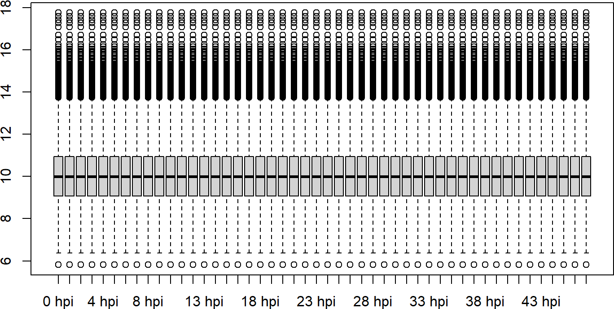
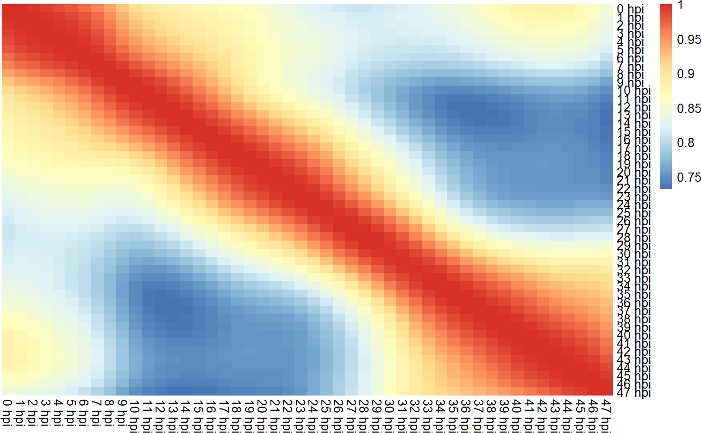
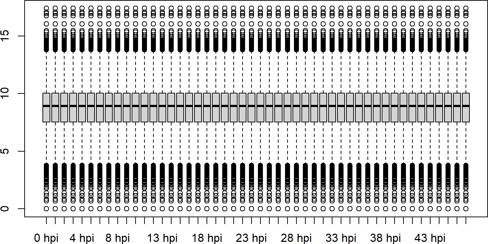
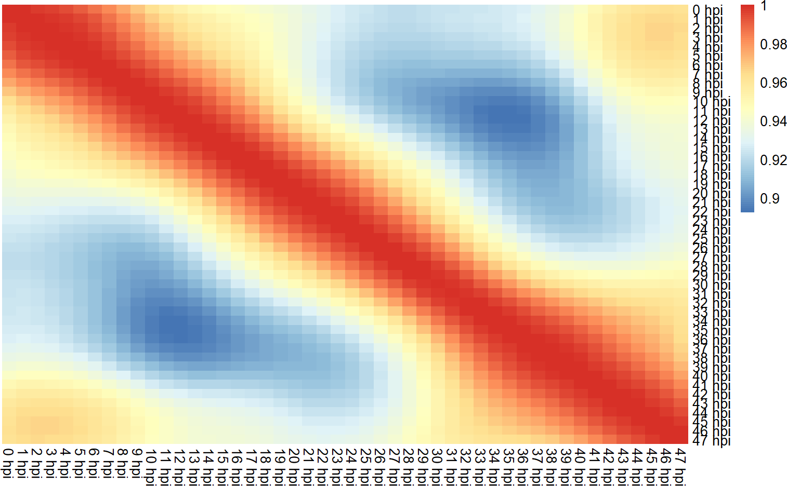

# Microarray data reanalysis

Abstract

This section covers examplary code on how one can reanalyze microarray
data of Apicomplexans (here Plasmodium as an example).

## Introduction

This vignette covers the example on how users can reanalyze the
Microarray data sets by updating the annotations from VEuPathDB
partially using
[`toGeneid()`](https://rohit-satyam.github.io/plasmoRUtils/reference/toGeneid.md)
and other R packages. It is important to do reanalysis before deciding
to reuse such dataset as annotations evolve since it will affect the
outcome of the analysis.

With release 71 of VEuPathDB, only users with subscription and API key
can access the database programmatically. Use
`usethis::edit_r_environ(scope = "user")` to add VEuPathDB API using
`VEUPATHDB_API_KEY` variable. By default, all the functions look for
`VEUPATHDB_API_KEY` variable for API key. Should you store your key
using any other variable, supply it using `api_key` argument in
VEuPathDB associated functions.

## Importing the dataset

``` r

## Loading necessary libraries
library(GEOquery)      # Querying the dataset from GEO
library(plasmoRUtils)  # For gene ID conversion
library(Biostrings)    # For sequence alignment
library(GenomicRanges) # For handling genomic coordinates
library(dplyr)         # For data wrangling
library(Biobase)       # access ExpressionSet assays and feature metadata
library(limma)         # probe summarisation and normalization
```

For demonstration purpose, we will use `GSE66669` from ([Painter et al.
2018](#ref-painter2018genome)). This is a time-series dataset that is
often used by *Plasmodium* community to annotate single cell atlas and
deconvolution tasks.

The `getGEO` function retrieves the microarray dataset as an
*ExpressionSet* object from GEO database. We will make a new column by
combining the Old Ids and the probe sequence since we know that there
can be multiple sequence for one probe ID and same probe ID for multiple
genes.

``` r

gse <- getGEO("GSE66669")
gse <- gse[[1L]]
class(gse)
#> [1] "ExpressionSet"
#> attr(,"package")
#> [1] "Biobase"
dim(gse) ## 14499 rows and 144 samples
#> Features  Samples 
#>    14499      144
featureNames(gse) %>% head() ## The features are ID number.
#> [1] "4" "5" "6" "7" "8" "9"
## probe information is stored in 
probedf <- fData(gse)
head(probedf)
#>   ID COL ROW                NAME CONTROL_TYPE ACCESSION_STRING       ORF
#> 4  4  96 158  PFL0815W_v7.1_P1/3        FALSE         PFL0815w  PFL0815w
#> 5  5  96 156  PFB0495W_v7.1_P3/4        FALSE         PFB0495w  PFB0495w
#> 6  6  96 154 PF13_0050_v7.1_P1/4        FALSE        PF13_0050 PF13_0050
#> 7  7  96 152 PF14_0416_v7.1_P1/2        FALSE        PF14_0416 PF14_0416
#> 8  8  96 150 PF11_0120_v7.1_P1/1        FALSE        PF11_0120 PF11_0120
#> 9  9  96 148  PFI1280C_v7.1_P5/9        FALSE         PFI1280c  PFI1280c
#>   CHROMOSOMAL_LOCATION                                    DESCRIPTION
#> 4             unmapped                DNA-binding chaperone, putative
#> 5             unmapped conserved Plasmodium protein, unknown function
#> 6             unmapped                 HORMA domain protein, putative
#> 7             unmapped                  zinc finger protein, putative
#> 8             unmapped conserved Plasmodium protein, unknown function
#> 9             unmapped                       protein kinase, putative
#>                                                       SEQUENCE
#> 4 TGAGTGGATGTAATTTAATATGGTTAGATAAAGCAACCAAAAAGAGGAGCAAGGATATAT
#> 5 GAAAGTTTACAGAGTGAGTTTGAAAAAGTAACAAAAACTAGTAAAAAGGGAGGTATACAT
#> 6 AAACAAATGAATATCCACCTGAAAACAACCTTCTATTAAACAGTAACGATATATACCCTC
#> 7 AAAAAAGATAGTTTAGCAAAAAACAAATATACTGGGTTATATGGACCTGTACGTAGTAGT
#> 8 CGAATTATCATGGCCTTGAAAAATCATTAAGAAGACGAGGAGGTAAGATAAAAACTATTT
#> 9 CTTGTTGATTGTAACAACAGATCATTGATGAATAAAAATGTAATGGATTTTGCACATATG
#>               SPOT_ID
#> 4  PFL0815W_v7.1_P1/3
#> 5  PFB0495W_v7.1_P3/4
#> 6 PF13_0050_v7.1_P1/4
#> 7 PF14_0416_v7.1_P1/2
#> 8 PF11_0120_v7.1_P1/1
#> 9  PFI1280C_v7.1_P5/9

## There are 29 rows for which ORF entry is missing 
table(probedf$ACCESSION_STRING==probedf$ORF)
#> 
#> FALSE  TRUE 
#>    29 14470
probedf$ACCESSION_STRING[probedf$ACCESSION_STRING!=probedf$ORF]
#>  [1] "RNAzID:1537"      "RNAzID:3967"      "ScGlucanSynthase" "U5RNA"           
#>  [5] "ScGlucanSynthase" "RNAzID:2132"      "RNAzID:1876"      "ScGlucanSynthase"
#>  [9] "ScGlucanSynthase" "RNAzID:1678"      "ScCD"             "ScUPRT"          
#> [13] "S1-type_28S:rRNA" "ScGlucanSynthase" "ScGlucanSynthase" "ScGlucanSynthase"
#> [17] "ScGlucanSynthase" "ScGlucanSynthase" "tetR"             "RNAzID:1743"     
#> [21] "ScGlucanSynthase" "ScGlucanSynthase" "ScGlucanSynthase" "ScGlucanSynthase"
#> [25] "ScGlucanSynthase" "RNAzID:3370"      "ScGlucanSynthase" "Rluciferase"     
#> [29] "ScGlucanSynthase"
probedf$ORF[probedf$ACCESSION_STRING!=probedf$ORF]
#>  [1] "" "" "" "" "" "" "" "" "" "" "" "" "" "" "" "" "" "" "" "" "" "" "" "" ""
#> [26] "" "" "" ""

## Let's make unique identifiers by combining the Accession_string and sequence for those probes for which toGeneid function will fail
probedf$unique <- paste0(probedf$SEQUENCE, ":", probedf$ACCESSION_STRING)
```

The row names matches the ID column. We can see that the old “PFL” ids
are present in the `ACCESSION_STRING` or `ORF` columns while the probe
sequences are present in `SEQUENCE` column. Some 29 rows contains some
*Plasmodium* ncRNAs (RNAzID), followed by several control probes (see
table below).

| Probe ID | What it Is | Purpose |
|----|----|----|
| **RNAzID:1537, 1678, 1743, 1876, 2132, 3370, 3967** | Predicted non-coding RNAs in the *Plasmodium* genome (identified by the RNAz algorithm) | To assay expression (or absence thereof) of structured ncRNAs—often used to explore regulatory RNAs or as negative controls when comparing to mRNA signals. |
| **U5RNA** | U5 small nuclear RNA | A core spliceosomal snRNA—serves as a housekeeping control for RNA integrity and normalization. |
| **S1-type_28S:rRNA** | A segment of 28S ribosomal RNA | Ribosomal RNA control for overall RNA loading and quality. |
| **ScGlucanSynthase** | *Saccharomyces cerevisiae* glucan synthase transcript | Spike-in control from yeastto: monitor labeling efficiency and hybridization consistency. |
| **ScCD** | *S. cerevisiae* cytosine deaminase | Another yeast spike-in for normalization across arrays. |
| **ScUPRT** | *S. cerevisiae* uracil phosphoribosyltransferase | Yeast spike-in control for detection sensitivity. |
| **tetR** | Bacterial tetracycline repressor | Exogenous control to check for cross-hybridization and labeling. |
| **Rluciferase** | Renilla luciferase | Reporter gene spike-in: assesses labeling and detection linearity. |

``` r

# retain only legacy IDs that map unambiguously to one current gene.
new <- toGeneid(inputid = unique(probedf$ACCESSION_STRING), from = "old", to = "ensembl") %>%
  dplyr::select(`Input ID`, `Gene ID`) %>% dplyr::distinct()
resolved <- new %>% dplyr::group_by(`Input ID`) %>%
  dplyr::filter(dplyr::n_distinct(`Gene ID`) == 1L) %>% dplyr::ungroup() 
ix <- match(probedf$ACCESSION_STRING, resolved$`Input ID`)
probedf$`Gene ID` <- resolved$`Gene ID`[ix]
unmappedprobes_df <- probedf[is.na(probedf$`Gene ID`) &
                               !is.na(probedf$SEQUENCE) & nzchar(probedf$SEQUENCE),
                             c("ACCESSION_STRING", "SEQUENCE", "unique"), drop = FALSE]
```

Some probes may fail to map uniquely through
[`toGeneid()`](https://rohit-satyam.github.io/plasmoRUtils/reference/toGeneid.md);
the number depends on the current VEuPathDB annotation. We therefore
attempt to map unresolved probe sequences to annotated mRNA sequences.
For 60-bp probes, we use
[`Biostrings::vmatchPattern()`](https://rdrr.io/pkg/Biostrings/man/matchPattern.html)
with `max.mismatch = 0`. Relaxing this threshold requires additional
specificity checks: an inexact hit must not be assumed to identify a
unique gene.

``` r

## retriving mRNA from plasmoDB
readVEuPathFasta <- function(url,
                             api_key = Sys.getenv("VEUPATHDB_API_KEY"),
                             timeout = 60) { 
  if (!nzchar(api_key)) stop("VEuPathDB API key is missing.")
  tmp <- tempfile(fileext = ".fasta")
  on.exit(unlink(tmp), add = TRUE)
  httr2::request(url) |>
    httr2::req_auth_bearer_token(api_key) |>
    httr2::req_timeout(timeout) |>
    httr2::req_perform(path = tmp)
  Biostrings::readDNAStringSet(tmp)
}

mrna_fasta <- readVEuPathFasta(
    paste0(
        "https://plasmodb.org/a/service/raw-files/release-71/",
        "Pfalciparum3D7/fasta/data/",
        "PlasmoDB-71_Pfalciparum3D7_AnnotatedTranscripts.fasta"
    )
)

# extract transcript identifiers and require a UNIQUE gene-level match.
names(mrna_fasta) <- sub("[[:space:]].*$", "", names(mrna_fasta)) 
probe_matches_zero <- lapply(unmappedprobes_df$SEQUENCE, function(seq) {
  Biostrings::vmatchPattern(seq, mrna_fasta, max.mismatch = 0)
})

# A probe matching several transcripts is acceptable only when all
# matching transcripts resolve to one gene. Otherwise leave it ambiguous.
exact_gene_hits <- lapply(probe_matches_zero, function(matches) {
  transcript_ids <- names(mrna_fasta)[lengths(matches) > 0L]
  gene_ids <- sub("\\.[0-9]+$", "", transcript_ids)
  gene_ids <- sub("-T[0-9]+$", "", gene_ids)
  unique(gene_ids)
})
unique_hit <- vapply(exact_gene_hits, function(ids) {
  if (length(ids) == 1L) ids else NA_character_
}, character(1))

# map by original probe row; do not expand ExpressionSet features.
missing_ix <- which(is.na(probedf$`Gene ID`) & !is.na(probedf$SEQUENCE) &
                      nzchar(probedf$SEQUENCE))
probedf$`Gene ID`[missing_ix] <- unique_hit

#explicitly reporting unresolved/multi-mapping probes for manual review.
ambiguous <- vapply(exact_gene_hits, length, integer(1)) > 1L
message(sum(ambiguous), " probes match multiple distinct genes and were not assigned.")
unresolved <- is.na(probedf$`Gene ID`)

## Adding a prefix to remove unmapped reads later when required
probedf$`Gene ID`[unresolved] <- paste0("UNMAPPED:",
    probedf$ACCESSION_STRING[unresolved], ":", rownames(probedf)[unresolved]) 

stopifnot(nrow(probedf) == nrow(Biobase::fData(gse))) 

stopifnot(identical(rownames(probedf), Biobase::featureNames(gse)))
```

> Exact matching does not guarantee unique mapping: paralogs, repeated
> transcripts and noncoding RNAs may share an identical probe sequence.
> Here the probes mapping to multiple genes are kept labelled as
> unresolved probe-level features rather than choosing a gene
> arbitrarily.

## Updating the feature data in the Expression set

We will now use limma’s
[`avereps()`](https://rdrr.io/pkg/limma/man/avereps.html) function to
average probe measurements per assigned gene ID. This is a descriptive
summarisation, not a replacement for probe-level reannotation or a full
differential-expression reanalysis.

``` r

fData(gse) <- probedf[featureNames(gse), , drop = FALSE] 

## retriving the intensity matrix
expr_matrix <- Biobase::exprs(gse) 
probes2genes <- Biobase::fData(gse)$`Gene ID` 
stopifnot(length(probes2genes) == nrow(expr_matrix))
gene.mat <- limma::avereps(expr_matrix, ID = probes2genes)

gene.mat %>% head() %>% .[,1:5]
#>               GSM1627532 GSM1627533 GSM1627534 GSM1627535 GSM1627536
#> PF3D7_1216900  4929.1199  4901.7775  4846.6257  4753.3563  4619.9623
#> PF3D7_0211100   321.2292   324.0473   326.6416   329.4834   335.1214
#> PF3D7_1309400   740.9756   752.7146   766.7923   783.4820   801.7903
#> PF3D7_1443800  1029.0478  1049.5709  1069.6907  1090.2481  1107.5859
#> PF3D7_1111400  1418.8720  1390.1635  1367.5520  1351.4528  1335.2197
#> PF3D7_0926100  2274.6915  2224.1830  2177.2646  2130.5968  2085.8498
```

## Checking correlation between samples of time series data

Before normalizing, inspect `summary(as.vector(Biobase::exprs(gse)))`
and the GEO platform processing notes to confirm whether the supplied
intensities are already log-transformed. The following examples avoid a
second log transformation.

This GSE series contains three sample types:

1.  Total RNA reflects the combined cellular transcript pool at each
    time point.

2.  Labeled (transcribed) captures only nascent RNA from the 10 min 4-TU
    pulse (a snapshot of newly labelled transcripts).

3.  Unlabeled (stabilized) RNA reflects transcripts not captured by the
    labeling pulse; this is not a direct RNA half-life measurement.

For more details read [Nascent in vivo mRNA labeling and capture
throughout the
IDC](https://pmc.ncbi.nlm.nih.gov/articles/PMC6037754/#Sec12) section of
the paper.

``` r

temp <- gse[,gse$characteristics_ch1.2=="sample type: Total RNA"]
sample_expr <- Biobase::exprs(temp)
gene.mat <- limma::avereps(sample_expr, ID = probes2genes) 
gene.mat <- gene.mat[!is.na(rownames(gene.mat)) & nzchar(rownames(gene.mat)), , drop = FALSE] 
## Remove control genes
gene.mat <- gene.mat[grepl("^PF3D7_", rownames(gene.mat)), , drop = FALSE]
colnames(gene.mat) <- temp$`time (hours post invasion):ch1`

gene.mat <- log2(limma::normalizeQuantiles(gene.mat)+1) ## Do not blindly lognormalise. Here from GEO database we know: Total, Labeled, and Unlabeled values calculated based on the intensity of Total Cy5 channel normalized to Cy3 reference and the estimated contributions of Labeled Cy5 and Unlabeled Cy3 to calculated Total Cy5.

boxplot(gene.mat)
```



``` r

coormat <- stats::cor(gene.mat, use = "pairwise.complete.obs")
pheatmap::pheatmap(coormat, cluster_rows = FALSE, cluster_cols = FALSE, border_color = NA)
```



For labeled data

``` r

temp <- gse[,gse$characteristics_ch1.2=="sample type: 4-TU Labeled RNA"]
sample_expr <- Biobase::exprs(temp) 
gene.mat <- limma::avereps(sample_expr, ID = probes2genes)
gene.mat <- gene.mat[!is.na(rownames(gene.mat)) & nzchar(rownames(gene.mat)), , drop = FALSE] 
gene.mat <- gene.mat[grepl("^PF3D7_", rownames(gene.mat)), , drop = FALSE]
colnames(gene.mat) <- temp$`time (hours post invasion):ch1`
gene.mat <- log2(limma::normalizeQuantiles(gene.mat)+1)
boxplot(gene.mat)
```



``` r

coormat <- stats::cor(gene.mat, use = "pairwise.complete.obs")
pheatmap::pheatmap(coormat, cluster_rows = FALSE, cluster_cols = FALSE, border_color = NA)
```



## Session Info

``` r

utils::sessionInfo()
#> R version 4.4.1 (2024-06-14 ucrt)
#> Platform: x86_64-w64-mingw32/x64
#> Running under: Windows 11 x64 (build 26200)
#> 
#> Matrix products: default
#> 
#> 
#> locale:
#> [1] LC_COLLATE=English_India.utf8  LC_CTYPE=English_India.utf8   
#> [3] LC_MONETARY=English_India.utf8 LC_NUMERIC=C                  
#> [5] LC_TIME=English_India.utf8    
#> 
#> time zone: Asia/Riyadh
#> tzcode source: internal
#> 
#> attached base packages:
#> [1] stats4    stats     graphics  grDevices utils     datasets  methods  
#> [8] base     
#> 
#> other attached packages:
#>  [1] limma_3.60.6         dplyr_1.2.1          GenomicRanges_1.56.2
#>  [4] Biostrings_2.72.1    GenomeInfoDb_1.40.1  XVector_0.44.0      
#>  [7] IRanges_2.38.1       S4Vectors_0.42.1     plasmoRUtils_1.1.3  
#> [10] rlang_1.3.0          readr_2.2.0          janitor_2.2.1       
#> [13] GEOquery_2.72.0      Biobase_2.64.0       BiocGenerics_0.50.0 
#> [16] BiocStyle_2.32.1    
#> 
#> loaded via a namespace (and not attached):
#>  [1] httr2_1.3.0             magrittr_2.0.5          snakecase_0.11.1       
#>  [4] otel_0.2.0              compiler_4.4.1          systemfonts_1.3.2      
#>  [7] vctrs_0.7.3             reshape2_1.4.5          rvest_1.0.5            
#> [10] stringr_1.6.0           pkgconfig_2.0.3         crayon_1.5.3           
#> [13] fastmap_1.2.0           promises_1.5.0          rmarkdown_2.32         
#> [16] tzdb_0.5.0              UCSC.utils_1.0.0        ragg_1.5.2             
#> [19] bit_4.6.0               purrr_1.2.2             xfun_0.62              
#> [22] zlibbioc_1.50.0         cachem_1.1.0            easyPubMed_3.1.6       
#> [25] jsonlite_2.0.0          later_1.4.8             parallel_4.4.1         
#> [28] R6_2.6.1                bslib_0.12.0            stringi_1.8.9          
#> [31] RColorBrewer_1.1-3      lubridate_1.9.5         jquerylib_0.1.4        
#> [34] Rcpp_1.1.2              bookdown_0.48           knitr_1.52             
#> [37] R.utils_2.13.0          timechange_0.4.0        tidyselect_1.2.1       
#> [40] rstudioapi_0.19.0       dichromat_2.0-1         yaml_2.3.12            
#> [43] codetools_0.2-20        websocket_1.4.4         curl_8.1.0             
#> [46] processx_3.9.0          tibble_3.3.1            plyr_1.8.9             
#> [49] bio3d_2.4-5             withr_3.0.3             S7_0.2.2               
#> [52] evaluate_1.0.5          desc_1.4.3              xml2_1.6.0             
#> [55] pillar_1.11.1           BiocManager_1.30.27     plotly_4.12.1          
#> [58] generics_0.1.4          vroom_1.7.1             chromote_0.5.1         
#> [61] hms_1.1.4               ggplot2_4.0.3           scales_1.4.0           
#> [64] glue_1.8.1              pheatmap_1.0.13         tools_4.4.1            
#> [67] data.table_1.18.6.1     fs_2.1.0                grid_4.4.1             
#> [70] tidyr_1.3.2             GenomeInfoDbData_1.2.12 cli_3.6.6              
#> [73] textshaping_1.0.5       viridisLite_0.4.3       gt_1.4.0               
#> [76] gtable_0.3.6            R.methodsS3_1.8.2       sass_0.4.10            
#> [79] digest_0.6.39           mgsub_2.0.0             htmlwidgets_1.6.4      
#> [82] farver_2.1.2            htmltools_0.5.9         pkgdown_2.2.1          
#> [85] R.oo_1.27.1             lifecycle_1.0.5         httr_1.4.9             
#> [88] statmod_1.5.2           bit64_4.8.6
```

## References

Painter, Heather J, Neo Christopher Chung, Aswathy Sebastian, Istvan
Albert, John D Storey, and Manuel Llinás. 2018. “Genome-Wide Real-Time
in Vivo Transcriptional Dynamics During Plasmodium Falciparum
Blood-Stage Development.” *Nature Communications* 9 (1): 2656.
