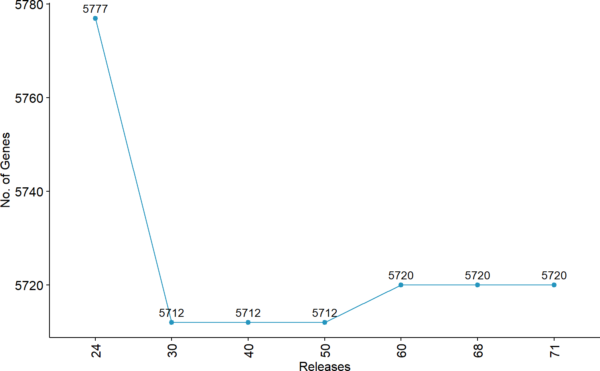
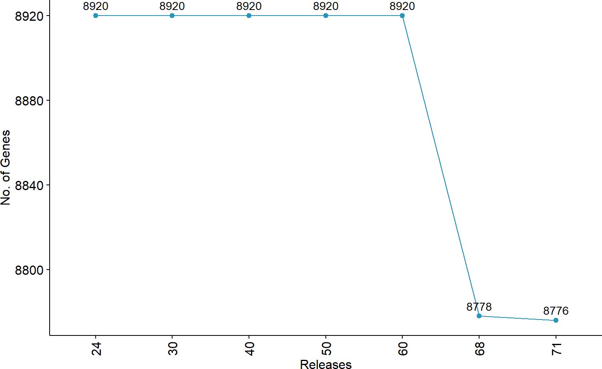
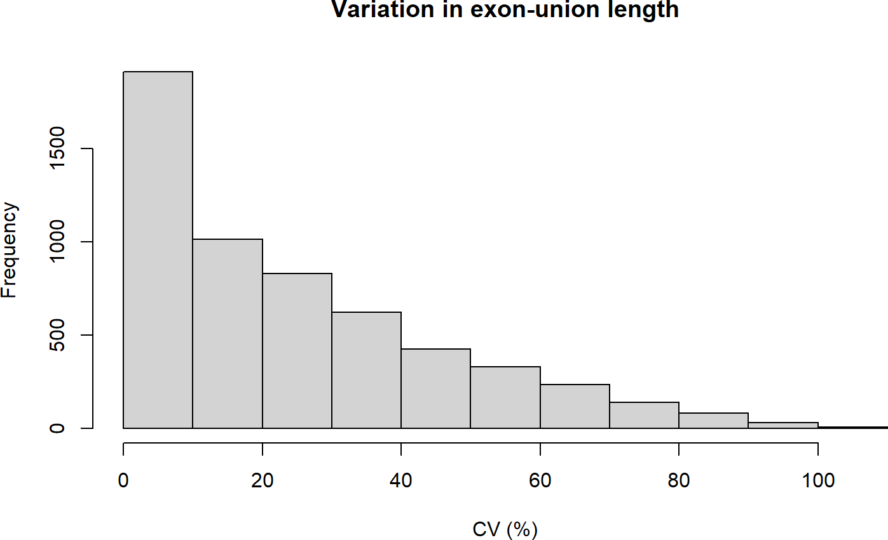
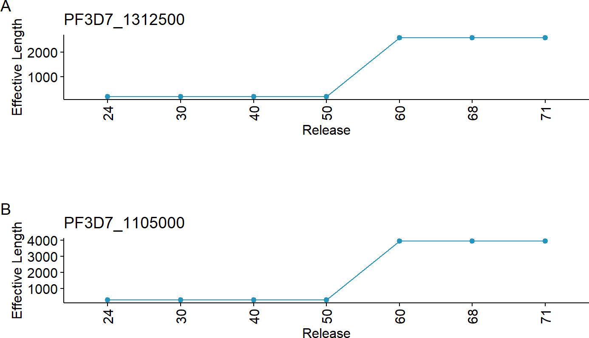
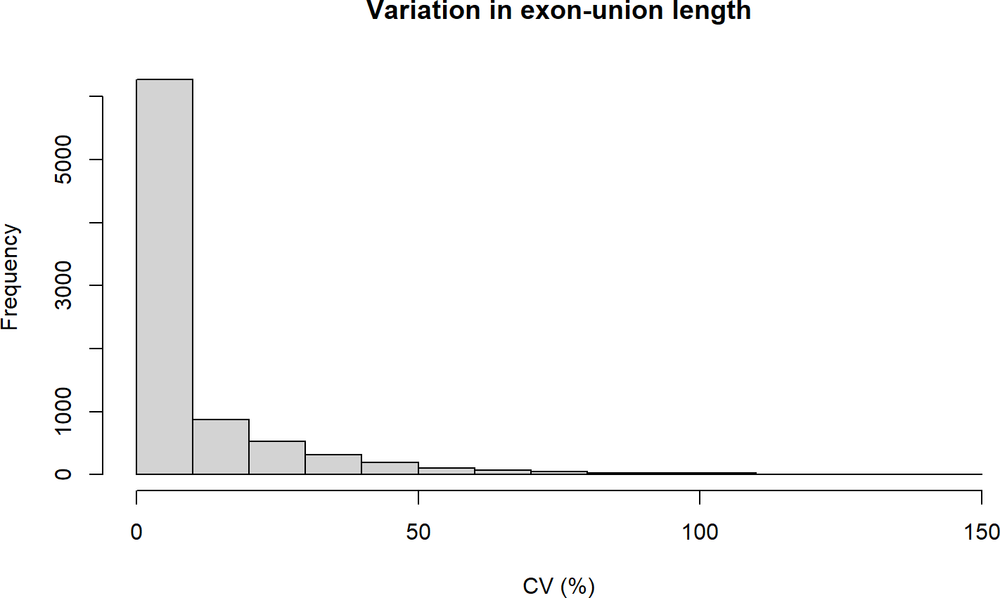
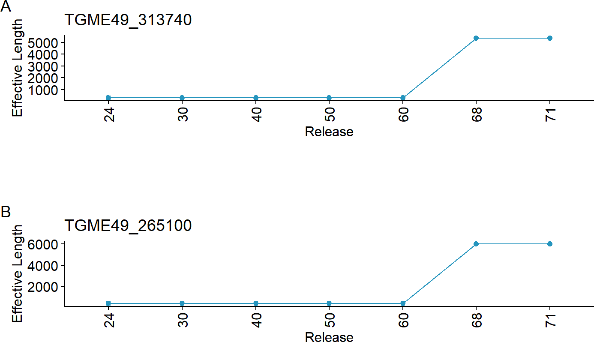

# RNASeq: Need for reanalysis?

Abstract

This section examines how annotations evolve across successive VEuPathDB
releases. As exon–intron boundaries are continually refined with
incoming sequencing data, tracking shifts in effective gene length
enables users to decide whether existing published datasets warrant
reanalysis based on the magnitude of those changes.

## Introduction

In the bioinformatics community, it is common to reuse published RNA-seq
count or normalized count data without reprocessing, often overlooking
important technical differences such as the version of genome
annotation. Assembly updates typically include revisions to:

- **GFF files**, where gene models and exon‐intron structures are
  updated, UTRs redefined etc.
- **GAF files**, where GO terms are revised based on newly published
  evidence

For RNA-seq, these updates can substantially affect downstream analyses
(e.g., over-representation or pathway enrichment). These changes are
often documented in the **NEWS** sections of VEuPathDB.

For instance, in *Plasmodium* and *Toxoplasma*, two key assembly updates
were:

- [Release 51 (16 Mar
  2021)](https://plasmodb.org/plasmo/app/static-content/PlasmoDB/news.html#PlasmoDB51Released)
  for **PlasmoDB**
- [Release 66 (28 Nov
  2023)](https://toxodb.org/toxo/app/static-content/ToxoDB/news.html#ToxoDB66Released)
  for **ToxoDB**, which included extensive gene‐model revisions

For RNA-seq, we focus on two annotation features that can affect
quantification and downstream biological interpretation. These include
changes in:

1.  **Number of Genes**
2.  **Exon–intron boundaries:** Measured here using the **union of
    annotated exons per gene**. This is an exon-union length, not an
    RNA-seq fragment-adjusted effective transcript length.

In the example below, we will use *Plasmodium* and *Toxoplasma* releases
and the *plasmoRUtils* function
[`getEffLen()`](https://rohit-satyam.github.io/plasmoRUtils/reference/getEffLen.md)
to track how effective gene lengths shift across versions.

With release 71 of VEuPathDB, only users with subscription and API key
can access the database programmatically. Use
`usethis::edit_r_environ(scope = "user")` to add VEuPathDB API using
`VEUPATHDB_API_KEY` variable. By default, all the functions look for
`VEUPATHDB_API_KEY` variable for API key. Should you store your key
using any other variable, supply it using `api_key` argument in
VEuPathDB associated functions.

## Assessing Changes in Gene Number

We will compare seven releases (`24, 30, 40, 50, 60, 68, and 71`) for
both *Plasmodium* and *Toxoplasma*. From the NEWS section, we know that
in *Plasmodium*, several loci initially annotated as rRNAs, lncRNAs, or
coding genes were later removed, and the mitochondrial genome of PF3D7
was revised in [2019](https://pubmed.ncbi.nlm.nih.gov/31080894/).
Similarly, *Toxoplasma* TGME49 gene models underwent extensive updates
in release 66.

``` r

library(plasmoRUtils)
library(dplyr)
library(tidyr)
library(tibble)
library(ggpubr) 

releases <- c(24, 30, 40, 50, 60, 68, 71) 

getEffLenVEuPath <- function(
    url,
    api_key = Sys.getenv("VEUPATHDB_API_KEY"),
    timeout = 120
) {

  if (!nzchar(api_key)) {
    stop(
      "VEuPathDB API key is missing.",
      call. = FALSE
    )
  }

  tmp <- tempfile(fileext = ".gff")
  on.exit(unlink(tmp), add = TRUE)

  httr2::request(url) |>
    httr2::req_auth_bearer_token(api_key) |>
    httr2::req_timeout(timeout) |>
    httr2::req_perform(path = tmp)

  getEffLen(tmp)
}


## Fetching GFFs from PlasmoDB and calculating effective lengths
pf3d7.gffs <- lapply(releases, function(x){
 paste0("https://plasmodb.org/a/service/raw-files/release-",x,"/Pfalciparum3D7/gff/data/PlasmoDB-",x,"_Pfalciparum3D7.gff") %>% getEffLenVEuPath() 
}) %>% setNames(releases) 

## Fetching GFFs from ToxoDB and calculating effective lengths
tgme49.gffs <- lapply(releases, function(x){
  Sys.sleep(20) ## because VEuPathDB gives timeout if too many files are fetched
  paste0("https://toxodb.org/a/service/raw-files/release-",x,"/TgondiiME49/gff/data/ToxoDB-",x,"_TgondiiME49.gff") %>% getEffLenVEuPath()
}) %>% setNames(releases)

## Let's plot changes in number of genes 
pf3d7.ngenes<- lapply(pf3d7.gffs, nrow)  %>% setNames(releases) %>% plyr::ldply()
tgme49.ngenes<- lapply(tgme49.gffs, nrow)  %>% setNames(releases) %>% plyr::ldply()

ggpubr::ggline(pf3d7.ngenes,x=".id",y="V1", label = TRUE, color = "#2595be", fill = "#2595be")+labs(x="Releases",y="No. of Genes")+theme(axis.text.x = element_text(angle = 90, vjust = 0.5))
```



``` r


ggpubr::ggline(tgme49.ngenes,x=".id",y="V1", label = TRUE, color = "#2595be", fill = "#2595be")+labs(x="Releases",y="No. of Genes")+theme(axis.text.x = element_text(angle = 90, vjust = 0.5))
```



The plotted values describe the number of annotated gene IDs with
computable exon-union lengths in each selected release. These counts
should not be interpreted as a direct count of genes gained or lost
without matching gene identifiers across releases.

## Assessing the difference in Effective gene lengths

To compare relative variation in exon-union length across releases, we
calculate the coefficient of variation:

`CV (%) = 100 × standard deviation / mean`

A gene with unchanged exon-union length across releases has CV = 0.
Higher CV indicates greater relative variability; for example, a 100-bp
difference matters more for a 200-bp feature than for a 5,000-bp
feature.

We will calculate CV using following steps:

1.  Because gene IDs may vary across releases, we will first convert
    unambiguous legacy gene IDs to current IDs using
    [`toGeneid()`](https://rohit-satyam.github.io/plasmoRUtils/reference/toGeneid.md)
    and retain genes represented in all selected releases.
2.  In old annotations like release 24, some genes coding for multiple
    transcripts are present as separate gene entries each coding for 1
    transcripts often denoted by versions before them such as
    `PF3D7_0618900.1,PF3D7_0618900.2`. This issue has been fixed in
    latest releases. To handle this we will remove the versions from
    gene IDs and average the exon-union lengths for duplicate legacy
    gene rows for descriptive comparison; this does not replace
    transcript-aware quantification.
3.  Calculate CV for genes with complete release coverage and identify
    those with CV greater than zero.

``` r

# map only unambiguous legacy IDs to a current gene ID.
map_legacy_ids <- function(df, annotation, organism, database) {
  legacy <- setdiff(unique(df$GeneID), unique(annotation$`Gene ID`))
  if (!length(legacy)) return(df)
  map <- toGeneid(legacy, from = "old", to = "ensembl") %>%
    dplyr::select(`Input ID`, `Gene ID`) %>%
    dplyr::distinct() %>%
    dplyr::group_by(`Input ID`) %>%
    dplyr::filter(dplyr::n_distinct(`Gene ID`) == 1L) %>%
    dplyr::ungroup()
  ix <- match(df$GeneID, map$`Input ID`)
  replace <- !is.na(ix)
  df$GeneID[replace] <- map$`Gene ID`[ix[replace]]
  df
}


###  Step1
# Remove version suffix from GeneIDs
df <- pf3d7.gffs %>% plyr::ldply() %>%
  mutate(GeneID = sub("\\.[0-9]+$", "", GeneID)) 

annot <- getTable(org = "Plasmodium falciparum 3D7", db = "plasmodb")
df <- map_legacy_ids(df, annot, "Plasmodium falciparum 3D7", "plasmodb") 
subdf <- df %>% dplyr::filter(GeneID %in% annot$`Gene ID`) 

###  Step 2 
# Aggregate length per gene across releases
df_agg <- subdf %>%
  group_by(.id, GeneID) %>%
  summarise(mean_length = round(mean(Length, na.rm = TRUE)), .groups = "drop") %>%
  pivot_wider(names_from = GeneID, values_from = mean_length, values_fill = NA) %>%
  column_to_rownames(".id") %>%
  as.matrix() %>% { stopifnot(setequal(rownames(.), as.character(releases))); .[, colSums(!is.na(.)) == length(releases), drop = FALSE] } 

###  Step 3
# Coefficient of variation across releases
cv <- apply(df_agg, 2, function(x) (sd(x, na.rm = TRUE) / mean(x, na.rm = TRUE)) * 100) %>%
  sort(decreasing = TRUE)

## How many genes have their effective exon length change >100 bp between versions 50 and 71
table((df_agg["71", ] - df_agg["50", ]) > 100) ##4434
#> 
#> FALSE  TRUE 
#>  1198  4434

## Check for how many genes the effective length has changed
table(cv > 0, useNA = "ifany")
#> 
#> FALSE  TRUE 
#>  1095  4537
hist(cv[is.finite(cv)], main = "Variation in exon-union length", xlab = "CV (%)") 
```



``` r


## Let's filter top 20 genes whose effective length has changed drastically and see what they are

annot %>%
  dplyr::select(`Gene ID`, `Product Description`) %>% 
  dplyr::distinct(`Gene ID`, .keep_all = TRUE) %>% 
  dplyr::filter(`Gene ID` %in% utils::head(names(cv), 20L)) %>%
  dplyr::mutate(cv = unname(cv[match(`Gene ID`, names(cv))])) %>% 
  dplyr::arrange(dplyr::desc(cv))
#> # A tibble: 20 × 3
#>    `Gene ID`     `Product Description`                                   cv
#>    <chr>         <chr>                                                <dbl>
#>  1 PF3D7_1312500 SCOT1 protein, putative                              105. 
#>  2 PF3D7_1105000 histone H4                                           104. 
#>  3 PF3D7_1102800 early transcribed membrane protein 11.2              104. 
#>  4 PF3D7_1252300 conserved Plasmodium protein, unknown function       102. 
#>  5 PF3D7_1133000 conserved Plasmodium protein, unknown function       102. 
#>  6 PF3D7_0926200 conserved Plasmodium protein, unknown function       101. 
#>  7 PF3D7_0627000 conserved Plasmodium protein, unknown function       100. 
#>  8 PF3D7_0221800 hypothetical protein                                  99.9
#>  9 PF3D7_0624500 anaphase-promoting complex subunit 11, putative       99.6
#> 10 PF3D7_0202800 conserved Plasmodium protein, unknown function        99.0
#> 11 PF3D7_0936000 ring-exported protein 2                               97.7
#> 12 PF3D7_1003500 40S ribosomal protein S20e, putative                  97.4
#> 13 PF3D7_1325700 conserved Plasmodium protein, unknown function        97.4
#> 14 PF3D7_0817800 respiratory chain complex 3 associated protein 3      97.4
#> 15 PF3D7_0323000 translation machinery-associated protein 7, putative  97.0
#> 16 PF3D7_0530000 conserved Plasmodium protein, unknown function        96.2
#> 17 PF3D7_1202900 high mobility group protein B1                        96.1
#> 18 PF3D7_1355800 splicing factor 3B subunit 5, putative                96.0
#> 19 PF3D7_1102700 early transcribed membrane protein 11.1               96.0
#> 20 PF3D7_0705700 40S ribosomal protein S29, putative                   95.5

# plot top 2 variable genes
plts <- names(cv)[1:2] %>%
  lapply(function(gid) {
    df %>%
      filter(GeneID == gid) %>%
      ggpubr::ggline(x = ".id", y = "Length",color = "#2595be", fill = "#2595be") +
      labs(title = gid, x = "Release", y = "Effective Length") +
      theme(axis.text.x = element_text(angle = 90, vjust = 0.5))
  })

library(sjPlot)
plot_grid(plts)
```



These comparisons show how annotation changes can alter exon-union
lengths. An observed difference in gene models motivates reassessing
older quantifications, but does not itself prove that every
corresponding RNA-seq read count will change.

> If you are working on annotation of hypothetical genes, you should be
> cautious about which assembly you use since your gene might appear to
> be down regulated as per old annotation but this might change with
> change in the current annotation.

Let’s recycle the code above for *Toxoplasma*.

``` r

###  Step1
# Remove version suffix from GeneIDs
df <- tgme49.gffs %>% plyr::ldply() %>%
  mutate(GeneID = sub("\\.[0-9]+$", "", GeneID)) # strip terminal version suffix

annot <- getTable(org = "Toxoplasma gondii ME49", db = "toxodb")
df <- map_legacy_ids(df, annot, "Toxoplasma gondii ME49", "toxodb")
subdf <- df %>% dplyr::filter(GeneID %in% annot$`Gene ID`)

###  Step 2 
# Aggregate length per gene across releases
df_agg <- subdf %>%
  group_by(.id, GeneID) %>%
  summarise(mean_length = round(mean(Length, na.rm = TRUE)), .groups = "drop") %>%
  pivot_wider(names_from = GeneID, values_from = mean_length, values_fill = NA) %>%
  column_to_rownames(".id") %>%
  as.matrix() %>% { stopifnot(setequal(rownames(.), as.character(releases))); .[, colSums(!is.na(.)) == length(releases), drop = FALSE] } 

###  Step 3
# Coefficient of variation across releases
cv <- apply(df_agg, 2, function(x) (sd(x, na.rm = TRUE) / mean(x, na.rm = TRUE)) * 100) %>%
  sort(decreasing = TRUE)

## How many genes have their effective exon length change >100 bp
table((df_agg["71", ] - df_agg["60", ]) > 100) # 2136
#> 
#> FALSE  TRUE 
#>  6342  2136

## Check for how many genes the effective length has changed
table(cv > 0, useNA = "ifany")
#> 
#> FALSE  TRUE 
#>  4947  3531
hist(cv[is.finite(cv)], main = "Variation in exon-union length", xlab = "CV (%)")
```



``` r


## Let's filter top 20 genes whose effective length has changed drastically and see what they are

annot %>%
  dplyr::select(`Gene ID`, `Product Description`) %>%
  dplyr::distinct(`Gene ID`, .keep_all = TRUE) %>% 
  dplyr::filter(`Gene ID` %in% utils::head(names(cv), 20L)) %>%
  dplyr::mutate(cv = unname(cv[match(`Gene ID`, names(cv))])) %>% 
  dplyr::arrange(dplyr::desc(cv))
#> # A tibble: 20 × 3
#>    `Gene ID`     `Product Description`                                   cv
#>    <chr>         <chr>                                                <dbl>
#>  1 TGME49_313740 zinc finger (CCCH type) motif-containing protein      140.
#>  2 TGME49_265100 hypothetical protein                                  137.
#>  3 TGME49_288850 hypothetical protein                                  131.
#>  4 TGME49_245440 PHD-finger domain-containing protein                  129.
#>  5 TGME49_223845 josephin domain-containing protein                    126.
#>  6 TGME49_313890 hypothetical protein                                  126.
#>  7 TGME49_231998 hypothetical protein                                  123.
#>  8 TGME49_291160 dynein light polypeptide 4, axonemal, putative        121.
#>  9 TGME49_311820 hypothetical protein                                  115.
#> 10 TGME49_230135 Kinesin-associated protein                            115.
#> 11 TGME49_500384 F-box domain-containing protein                       114.
#> 12 TGME49_500273 hypothetical protein, conserved                       113.
#> 13 TGME49_209945 hypothetical protein                                  113.
#> 14 TGME49_254140 DNA-directed RNA polymerase II RPABC4                 111.
#> 15 TGME49_244890 cyclin, putative                                      110.
#> 16 TGME49_310177 hypothetical protein                                  110.
#> 17 TGME49_240790 dynein light chain, putative                          107.
#> 18 TGME49_260825 hypothetical protein                                  107.
#> 19 TGME49_308830 dual specificity protein phosphatase                  107.
#> 20 TGME49_261470 U6 snRNA-associated Sm family protein LSm6, putative  107.

# plot top 2 variable genes
plts <- names(cv)[1:2] %>%
  lapply(function(gid) {
    df %>%
      filter(GeneID == gid) %>%
      ggpubr::ggline(x = ".id", y = "Length",color = "#2595be", fill = "#2595be") +
      labs(title = gid, x = "Release", y = "Effective Length") +
      theme(axis.text.x = element_text(angle = 90, vjust = 0.5))
  })

library(sjPlot)
plot_grid(plts)
```



The same procedure shows which shared *Toxoplasma* genes changed their
exon-union lengths between the selected releases.

## Discussion

The scope of reannotation influences the comparability of legacy
datasets; whether reprocessing is required depends on the type of
analysis, genome assembly, annotation changes and quantification method.
A prior survey of PlasmoDB datasets suggested that many published
analyses relied on annotations predating release 51; any reported counts
should be interpreted relative to the survey date rather than as live
database statistics. For analyses sensitive to gene-model changes,
reprocessing against a documented, up-to-date reference is preferable
when compatible raw data are available. When reanalysis is warranted,
users should document the precise reference assembly, annotation release
and quantification workflow.

## Session

``` r

utils::sessionInfo()
#> R version 4.4.1 (2024-06-14 ucrt)
#> Platform: x86_64-w64-mingw32/x64
#> Running under: Windows 11 x64 (build 26200)
#> 
#> Matrix products: default
#> 
#> 
#> locale:
#> [1] LC_COLLATE=English_India.utf8  LC_CTYPE=English_India.utf8   
#> [3] LC_MONETARY=English_India.utf8 LC_NUMERIC=C                  
#> [5] LC_TIME=English_India.utf8    
#> 
#> time zone: Asia/Riyadh
#> tzcode source: internal
#> 
#> attached base packages:
#> [1] stats     graphics  grDevices utils     datasets  methods   base     
#> 
#> other attached packages:
#>  [1] sjPlot_2.9.0       ggpubr_1.0.0       ggplot2_4.0.3      tibble_3.3.1      
#>  [5] tidyr_1.3.2        dplyr_1.2.1        plasmoRUtils_1.1.3 rlang_1.3.0       
#>  [9] readr_2.2.0        janitor_2.2.1      BiocStyle_2.32.1  
#> 
#> loaded via a namespace (and not attached):
#>   [1] RColorBrewer_1.1-3          rstudioapi_0.19.0          
#>   [3] jsonlite_2.0.0              magrittr_2.0.5             
#>   [5] GenomicFeatures_1.56.0      farver_2.1.2               
#>   [7] rmarkdown_2.32              fs_2.1.0                   
#>   [9] BiocIO_1.14.0               zlibbioc_1.50.0            
#>  [11] ragg_1.5.2                  vctrs_0.7.3                
#>  [13] memoise_2.0.1               Rsamtools_2.20.0           
#>  [15] RCurl_1.98-1.20             rstatix_1.1.0              
#>  [17] progress_1.2.3              S4Arrays_1.4.1             
#>  [19] htmltools_0.5.9             curl_8.1.0                 
#>  [21] broom_1.0.13                SparseArray_1.4.8          
#>  [23] Formula_1.2-6               sass_0.4.10                
#>  [25] bslib_0.12.0                htmlwidgets_1.6.4          
#>  [27] desc_1.4.3                  plyr_1.8.9                 
#>  [29] httr2_1.3.0                 plotly_4.12.1              
#>  [31] lubridate_1.9.5             cachem_1.1.0               
#>  [33] gt_1.4.0                    GenomicAlignments_1.40.0   
#>  [35] lifecycle_1.0.5             pkgconfig_2.0.3            
#>  [37] Matrix_1.7-6                R6_2.6.1                   
#>  [39] fastmap_1.2.0               GenomeInfoDbData_1.2.12    
#>  [41] MatrixGenerics_1.16.0       snakecase_0.11.1           
#>  [43] digest_0.6.39               AnnotationDbi_1.74.0       
#>  [45] S4Vectors_0.42.1            textshaping_1.0.5          
#>  [47] GenomicRanges_1.56.2        RSQLite_3.53.3             
#>  [49] labeling_0.4.3              filelock_1.0.3             
#>  [51] timechange_0.4.0            httr_1.4.9                 
#>  [53] abind_1.4-8                 compiler_4.4.1             
#>  [55] bit64_4.8.6                 withr_3.0.3                
#>  [57] S7_0.2.2                    backports_1.5.1            
#>  [59] BiocParallel_1.38.0         carData_3.0-6              
#>  [61] DBI_1.3.0                   biomaRt_2.60.1             
#>  [63] ggsignif_0.6.4              rappdirs_0.3.4             
#>  [65] DelayedArray_0.30.1         rjson_0.2.23               
#>  [67] tools_4.4.1                 chromote_0.5.1             
#>  [69] otel_0.2.0                  glue_1.8.1                 
#>  [71] restfulr_0.0.17             promises_1.5.0             
#>  [73] grid_4.4.1                  reshape2_1.4.5             
#>  [75] generics_0.1.4              gtable_0.3.6               
#>  [77] tzdb_0.5.0                  websocket_1.4.4            
#>  [79] data.table_1.18.6.1         hms_1.1.4                  
#>  [81] utf8_1.2.6                  xml2_1.6.0                 
#>  [83] car_3.1-5                   XVector_0.44.0             
#>  [85] BiocGenerics_0.50.0         pillar_1.11.1              
#>  [87] stringr_1.6.0               vroom_1.7.1                
#>  [89] later_1.4.8                 BiocFileCache_2.12.0       
#>  [91] lattice_0.23-1              rtracklayer_1.64.0         
#>  [93] bit_4.6.0                   tidyselect_1.2.1           
#>  [95] Biostrings_2.72.1           knitr_1.52                 
#>  [97] gridExtra_2.3.1             bookdown_0.48              
#>  [99] IRanges_2.38.1              SummarizedExperiment_1.34.0
#> [101] stats4_4.4.1                xfun_0.62                  
#> [103] Biobase_2.64.0              matrixStats_1.5.0          
#> [105] stringi_1.8.9               UCSC.utils_1.0.0           
#> [107] bio3d_2.4-5                 yaml_2.3.12                
#> [109] evaluate_1.0.5              codetools_0.2-20           
#> [111] BiocManager_1.30.27         cli_3.6.6                  
#> [113] systemfonts_1.3.2           processx_3.9.0             
#> [115] jquerylib_0.1.4             dichromat_2.0-1            
#> [117] Rcpp_1.1.2                  GenomeInfoDb_1.40.1        
#> [119] dbplyr_2.6.0                png_0.1-9                  
#> [121] XML_3.99-0.25               parallel_4.4.1             
#> [123] pkgdown_2.2.1               blob_1.3.0                 
#> [125] easyPubMed_3.1.6            prettyunits_1.2.0          
#> [127] bitops_1.1-0                txdbmaker_1.0.1            
#> [129] viridisLite_0.4.3           mgsub_2.0.0                
#> [131] scales_1.4.0                purrr_1.2.2                
#> [133] crayon_1.5.3                KEGGREST_1.44.1            
#> [135] rvest_1.0.5
```
